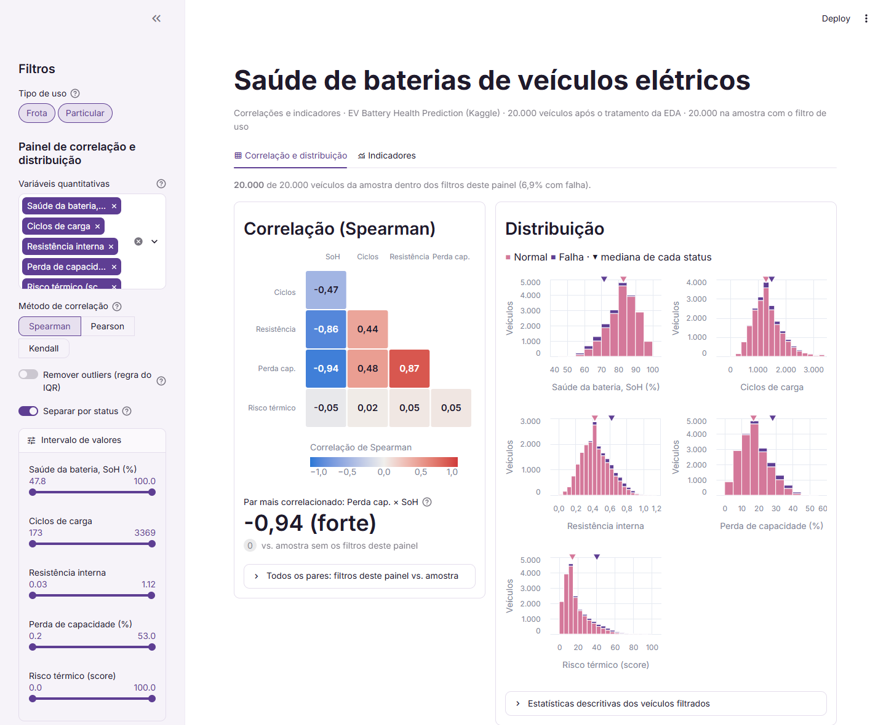
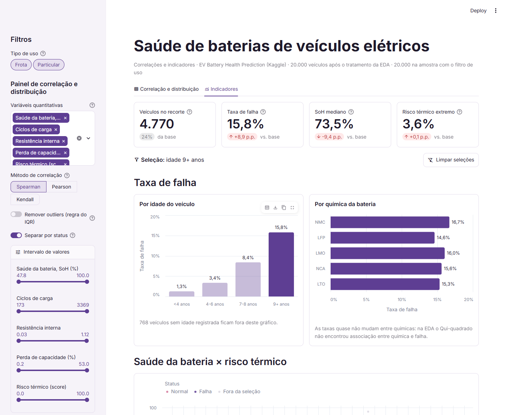

# Saúde de baterias de veículos elétricos

App em Streamlit com dois dashboards construídos a partir da minha EDA do dataset
[EV Battery Health Prediction](https://www.kaggle.com/datasets/srisyra02/ev-battery-health-prediction-dataset-20k)
(Kaggle, 20.000 veículos elétricos, 70 atributos), feita na Aula 11 da disciplina Análise e Visualização
de Dados (CESAR School, 2026.2). Atividade das Aulas 21, 22 e 23.

**Link do app:** https://avd-baterias-ev.streamlit.app/

| Dashboard 1: correlação e distribuição | Dashboard 2: indicadores |
|---|---|
|  |  |

## Os dashboards

**Dashboard 1: correlação + distribuição** das 5 variáveis quantitativas da EDA: saúde da bateria (SoH),
ciclos de carga, resistência interna, perda de capacidade e risco de thermal runaway.

- Heatmap da correlação (Spearman por padrão, porque nenhuma variável passou no Shapiro-Wilk da EDA;
  Pearson e Kendall também disponíveis), mostrando só o triângulo inferior.
- O par mais correlacionado aparece em destaque, junto com a diferença para a amostra sem filtros.
  Isso responde à pergunta da Aula 21: remover valores extremos muda a correlação?
- Histogramas de cada variável com a mediana marcada, com opção de separar por status (Normal / Falha).
- Widgets na sidebar: seletor de variáveis, método, remover outliers (regra do IQR da EDA), separar por
  status e um slider de intervalo por variável.

**Dashboard 2: KPIs** para a gestão de manutenção de uma frota decidir quais veículos inspecionar primeiro.

- 4 métricas (`st.metric`): veículos no recorte, taxa de falha, SoH mediano e risco térmico extremo,
  cada uma comparada com a base completa.
- 3 visuais em Altair com **seleção cruzada**: clicar numa barra (idade do veículo ou química da bateria)
  ou arrastar uma área na dispersão SoH × risco térmico filtra os KPIs e os outros gráficos.
- Justificativa de cada métrica em [entregas/justificativa-metricas.md](entregas/justificativa-metricas.md).

O filtro de **tipo de uso** (frota ou particular) na sidebar vale para os dois dashboards.

## Principais achados

- A taxa de falha da base é 6,9% e cresce com a idade do veículo: 1,3% abaixo de 4 anos e 15,8% com 9 anos
  ou mais.
- SoH baixo e risco térmico alto são sinais **independentes** (Spearman −0,05) que, juntos, concentram as
  falhas: com SoH até 70% e risco acima de 50, a taxa de falha é de 84,6%; com SoH acima de 90% e risco até
  15, nenhuma falha.
- SoH, perda de capacidade e resistência interna medem a mesma degradação (correlações de −0,94 e −0,86).
- Remover os outliers pela regra do IQR tira 1.504 veículos e derruba a taxa de falha de 6,9% para 4,8%.
  Isso confirma a decisão da EDA de mantê-los: os valores extremos são justamente as baterias em falha.
- Química da bateria, tipo de uso, tipo de veículo e terreno não mudam a taxa de falha (Qui² p > 0,4).

## Stack

Python 3.12 · Streamlit 1.66 · Altair · pandas · SciPy (testes da EDA) · kagglehub · Jupyter (notebooks).

Identidade visual em [.streamlit/config.toml](.streamlit/config.toml): roxo `#5e3e93` (Falha) e rosa
`#d4789a` (Normal), a mesma convenção de cores da EDA, com tons ajustados para contraste e daltonismo.
Fonte: Inter.

## Como rodar localmente

Requer Python 3.11 a 3.15.

```bash
# Windows (PowerShell): py -m venv .venv ; .venv\Scripts\Activate.ps1
python3 -m venv .venv
source .venv/bin/activate

python -m pip install -r requirements.txt
streamlit skills --yes   # opcional: skills de IA do Streamlit
streamlit run app.py
```

### Testes de interface

21 testes com Playwright + pytest abrem o app num navegador de verdade e cobrem as duas abas: avisos com
0, 1 e 2+ variáveis, troca de método, remoção de outliers, sliders, cliques e Shift + clique nas barras,
área arrastada na dispersão, botão Limpar seleções, filtro de tipo de uso, tabelas, layout de celular e
funcionamento sem acesso ao Google Fonts. Cada teste também falha se aparecer exceção do Python na tela ou
erro no console do navegador.

```bash
python -m pip install -r requirements-dev.txt
python -m playwright install chromium
python -m pytest            # sobe o app sozinho numa porta livre (cerca de 2 min)
python -m pytest --headed   # para ver o navegador executando os testes
```

Sem o download do Chromium, dá para usar o Edge ou o Chrome instalados:
`python -m pytest --browser-channel msedge`.

Os mesmos testes rodam contra o app publicado. A variável `APP_URL` aponta para o endereço interno
`/~/+/`, que é o app sem a moldura do Streamlit Cloud:

```bash
APP_URL="https://avd-baterias-ev.streamlit.app/~/+/" python -m pytest      # macOS / Linux
$env:APP_URL="https://avd-baterias-ev.streamlit.app/~/+/"; python -m pytest  # Windows (PowerShell)
```

Para regenerar os dados, rode `notebooks/eda-com-downloads.ipynb` do início ao fim: ele baixa o dataset do
Kaggle com o `kagglehub` (versão 1, fixada para a análise ser reprodutível) e salva `data/raw/dataset.csv`
(bruto, fora do Git) e `data/clean/dataset.csv` (tratado, lido pelo app).

## Estrutura

```text
app.py                         # app: sidebar, abas e os dois dashboards
src/
  data_loader.py               # leitura do CSV tratado com @st.cache_data (só as colunas usadas)
  constantes.py                # variáveis, rótulos e cores
  estatisticas.py              # IQR, correlação e tabela descritiva (Dashboard 1)
  metricas.py                  # KPIs e formatação (Dashboard 2)
  graficos.py                  # gráficos Altair
data/clean/dataset.csv         # dataset tratado (20.000 x 73, 8,8 MB), versionado
data/raw/                      # dataset bruto, não versionado
notebooks/
  eda.ipynb                    # minha EDA original da Aula 11, sem alterações
  eda-com-downloads.ipynb      # EDA + exportação de data/raw e data/clean
  metricas-dashboard2.ipynb    # teste das métricas e plots prévios do Dashboard 2
  arquivo-eda-original.ipynb   # EDA de referência do professor (Heart Disease)
tests/                         # testes de interface (Playwright + pytest)
entregas/                      # rascunhos dos dashboards e justificativa das métricas
prompts/                       # template de prompt e declaração de uso de IA
docs/                          # screenshots do README
.streamlit/config.toml         # tema
```

## Dados

O EV Battery Health Prediction é um dataset público e sintético do Kaggle. `vehicle_id` e
`battery_serial` são códigos fictícios, sem dados pessoais. Por isso `data/clean/dataset.csv` está
versionado: o Streamlit Community Cloud só enxerga o que está no repositório. O CSV tem 8,8 MB, bem abaixo
do limite de 100 MB do GitHub, e o app lê só as 13 colunas que usa.

Passo a passo das aulas e checklist de deploy: [ROTEIRO.md](ROTEIRO.md).

## Uso de IA

Uso declarado em [prompts/declaracao-uso-ia.md](prompts/declaracao-uso-ia.md), conforme o Plano de Ensino.
